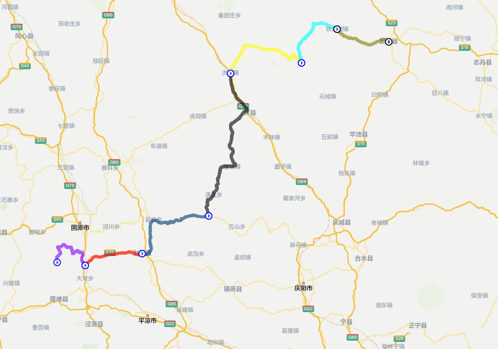

# 长征路 - 翻越六盘山

> **转换说明（非原文）**
>
> - 原文 7 页，含文字层和 1 幅内嵌路线图。正文按原顺序逐页转录，**未改字、未删节、未合并段落**；原文的错字（如「南飞燕」）、对话残留、草稿残片、编号错乱全部保留。只做排版归一：全角「：」改空格、中文引号统一为「」、`•` 列表项改为 Markdown 列表、数字与汉字间补空格。
> - 原文表格由 PDF 排版生成，`pdftotext` 按列切分后行序错位；已依据「行内单位统一 + 合计行求和 + 耗时相加」三重校验重排成 Markdown 表格。错行原貌见附录 C。
> - 校订、矛盾与待核项一律写在同目录 `roadbook.checks.md`，本文件只做转录。
> - 原文使用 U+2011（非断连字符）表示区间，如 `6‑8km`，转录时原样保留。

## 一、开篇

本路书是四渡赤水的续篇，本次复刻当年红一方面军的长征路的一小段——翻越六盘山，那是 1935 年 10 月初，毛主席记录，天高云淡，望断南飞燕，应是黄土高原比较舒适的天气。考虑到相似的气候条件，可用的时间段为 4 月底和 10 月中。本次徒步活动，对于公路段，采用摩托化行军方式，对于山路，羊肠小道，则徒步前进。

### 清平乐 - 六盘山（毛泽东，1935.10）

> 天高云淡，望断南飞雁  
> 不到长城非好汉，屈指行程二万  
> 六盘山上高峰，红旗漫卷西风  
> 今日长缨在手，何时缚住苍龙？

## 二、日段记录（原稿编号保留）

### ③ 张易堡 → 六盘山主峰 → 青石嘴（10.7，翻越六盘山）

- **里程**：约 17km（张易堡上山→山顶→下山青石嘴）
- **海拔**：起点张易堡 2100m；六盘山顶 2928m；终点青石嘴 2240m
- **爬升**：上山净 +828m；下山净 −688m；单日最大爬升段
- **道路**：山间红军小道（羊肠土路），盘旋六重山梁，林间窄径，不是西兰公路主路；西兰公路的六盘山盘山道在另一侧和尚铺，红军避开那条公路
- **备注**：下山后青石嘴战斗，歼灭东北军骑兵 2 个连

### 【六盘山之后：青石嘴 → 吴起镇（10.7–10.19）】

#### ① 青石嘴 → 白杨城（彭阳城，10.8）

- **里程**：约 28km
- **海拔**：起点青石嘴 2240m；白杨城 1740m
- **净下降**：−500m，离开六盘山地，进入黄土残塬沟壑区
- **道路**：黄土塬边土路、沟谷便道；塬面相对平坦，下沟陡坡泥泞，遇敌遭遇战
- **备注**：白杨城遇邓宝珊部，击溃敌军，当晚分两路宿营乔家渠、草庙

#### ② 白杨城 → 镇原三岔（10.9–10.11）

- **里程**：约 42km
- **海拔**：白杨城 1740m；三岔镇 1450m
- **净下降**：−290m，大量黄土沟壑，不断下塬、爬小峁，起伏频繁
- **道路**：黄土塬、沟壑人行小路，没有正规公路；沟底容易陷泥，塬上多浮土

#### ③ 三岔 → 环县洪德城（10.12–10.16）

- **里程**：约 55km
- **海拔**：三岔 1450m；洪德城 1320m
- **净下降**：−130m；沿环江河谷北侧黄土梁行进，断续小起伏
- **道路**：河谷旁乡间土路、山梁小道；河谷地带稍平缓，山梁路段风大缺水
- **备注**：一路有敌骑兵尾随，后卫持续警戒

#### ④ 洪德城 → 铁角城（老爷山，10.17）

- **里程**：约 32km
- **海拔**：洪德 1320m；老爷山（铁角城）1720m
- **净爬升**：+400m，再次抬升到子午岭西缘高地
- **道路**：黄土梁峁小路，荒僻少村落，缺水，彭德怀指挥部设在老爷山药王洞

#### ⑤ 铁角城 → 子午岭分水岭（10.18）

- **里程**：约 14km
- **海拔**：老爷山 1720m；分水岭垭口 1760m
- **净爬升**：+40m；子午岭是甘陕界山，翻过垭口即进入陕西
- **道路**：林区边缘黄土山路，荒草多，人烟稀少

#### ⑥ 子午岭分水岭 → 吴起镇（10.19 傍晚）

- **里程**：约 26km
- **海拔**：分水岭 1760m；吴起镇 1420m
- **净下降**：−340m，一路下坡进入陕北川道
- **道路**：黄土沟壑小路、塬边小径；无公路
- **备注**：19 日傍晚抵达吴起镇；21 日吴起镇「切尾巴战斗」

## 三、旧版草稿残片（第 3 页）

原文此处只剩一个「简介」标题，下接 D0、D1 和残缺的 D2，与后文 6 天方案冲突（旧版 D1 当天返回固原）：

1. **D0**：固原集结，可飞抵固原六盘山机场，入住固原市的酒店
2. **D1**：翻越六盘山，到达青石嘴，回到固原的酒店
3. **D2**：（正文缺失）

其后是一张 6 段里程表：

| 段 | 路线 | 里程 (km) | 估算累计爬升 (m) |
|---:|---|---:|---:|
| 1 | 莲花沟口→青石嘴 | 17 | 740 |
| 2 | 白杨城→乔家渠 | 16 | 320 |
| 3 | 三岔镇→老爷岭塬 | 14 | 380 |
| 4 | 洪德城→环河塬梁 | 15 | 420 |
| 5 | 铁角城→白涧塬 | 13 | 360 |
| 6 | 吴起纪念馆→头道川山梁 | 12 | 240 |

## 四、6 天重走陕甘支队路书（第 4–7 页）

> 原文本节开头是一句对话残片，原文照录：「抱歉理解错了！是表格渲染显示体验不佳，不是删除表格，下面重新用规整 Markdown 表格输出完整 6 天方案，所有你的调整全部保留：D1 短徒步挪 D2；D2+D3 合并；D4‑D6 合并为 D3；D7 短徒步挪 D5；新增独立 D6 延安研学日。」

### 6 天重走陕甘支队路书（Markdown 规整表格版）

**规则**：仅成熟公开轨迹做长距离徒步；其余区间全员乘车；保障车只托运行李，徒步过程不载人；全部红色点位无遗漏。

#### D1｜六盘山徒步翻越 — 青石嘴 — 彭阳县城

| 项目 | 内容 | 里程 | 预计耗时 |
|---|---|---|---|
| 长距离徒步（成熟轨迹） | 六盘山莲花沟口 → 青石嘴战斗遗址，爬升约 600m | 17km，爬山 600m | 7h |
| 乘车 1 | 固原/六盘山机场 → 六盘山徒步起点 | 52km | 1.5h |
| 乘车 2 | 青石嘴战斗遗址 → 彭阳县城住宿 | 71km | 1h |
| **当日合计乘车** |  | **123km** | **9.5h** |
| 住宿 | 彭阳县城 | ‑ | ‑ |

#### D2｜彭阳县城‑乔家渠‑三岔镇‑河连湾

| 项目 | 内容 | 里程 | 预计耗时 |
|---|---|---|---|
| 乘车 1 | 彭阳县城 → 乔家渠毛泽东宿营地 | 13km | 0.5h |
| 短徒步（成熟步道） | 乔家渠战国秦长城山脊往返 | 6‑8km，爬升 100m | 3h |
| 乘车 2 | 乔家渠 → 三岔长征纪念园（天主教堂）；三岔旧址短步行 2km | 105km | 2h |
| 乘车 3 | 三岔镇 → 河连湾战斗遗址；河连湾塬面旧址短步行 3‑4km | 78km | 2h |
| **当日合计乘车** |  | **196km** | **7.5h** |
| 住宿 | 洪德镇（备选：河连湾农家） | ‑ | ‑ |

#### D3｜河连湾‑兴隆山‑铁角城‑张湾子

| 项目 | 内容 | 里程 | 预计耗时 |
|---|---|---|---|
| 乘车 1 | 河连湾 → 兴隆山山脚 | 47km | 1h |
| 短徒步（成熟步道） | 兴隆山山脚‑道观山脊往返 | 7km | 3h |
| 乘车 2 | 兴隆山 → 铁角城村；药王洞周边短步行 2‑3km | 72km | 2h |
| 乘车 3 | 铁角城村 → 张湾子毛主席宿营地；旧居周边短步行 2km | 38km | 1h |
| **当日合计乘车** |  | **157km** | **7h** |
| 住宿 | 铁边城镇 | ‑ | ‑ |

#### D4｜张湾子 → 吴起镇胜利山（核心长距离徒步）

| 项目 | 内容 | 里程 | 预计耗时 |
|---|---|---|---|
| 长距离徒步（成熟轨迹） | 张湾子村 → 吴起镇城区，头道川乡村土路轨迹 | 32km | 10h |
| 乘车 1 | 铁边城镇住宿点 → 张湾子徒步起点 | 3km | 0.3h |
| 乘车 2 | 吴起徒步终点 → 吴起县城住宿 | 2km | 0.2h |
| **当日合计乘车** |  | **5km** | **10.5h** |
| 住宿 | 吴起县城 | ‑ | ‑ |

#### D5｜吴起县城‑胜利山‑志丹‑瓦窑堡‑延安市区

| 项目 | 内容 | 里程 | 预计耗时 |
|---|---|---|---|
| 短徒步（成熟景区步道） | 胜利山长征纪念园（切尾巴战斗遗址）往返 | 3‑4km | 2h |
| 乘车 1 | 吴起县城 → 志丹县；志丹陵园短步行 2km | 78km | 2h |
| 乘车 2 | 志丹 → 子长瓦窑堡会议会址；会址片区短步行 2km | 62km | 2h |
| 乘车 3 | 子长 → 延安市区 | 90km | 2h |
| **当日合计乘车** |  | **230km** | **8h** |
| 住宿 | 延安市区 | ‑ | ‑ |

#### D6｜延安革命旧址群、宝塔山片区 独立参观学习日（新增）

| 项目 | 内容 | 里程 | 预计耗时 |
|---|---|---|---|
| 片区步行游览 | 宝塔山、延安革命纪念馆、王家坪、杨家岭、枣园旧址群 | 6‑7km | ‑ |
| 当日合计乘车 | 市区短途接驳，不计总里程 | ‑ | ‑ |
| 住宿 | 延安市区（行程结束） | ‑ | ‑ |

### 全局汇总

| 统计项 | 里程 | 备注 |
|---|---|---|
| 累计长途乘车总里程 | 711km | D6 市区接驳不计入 |
| 核心长距离成熟徒步 | 49km | D1：17km；D4：32km |
| 点位成熟短徒步合计 | 31‑34km | 全部景区 / 村边成熟步道，无野路开荒 |

### 风险提示

1. D2、D3 单日乘车强度大，山区县道居多，必须提早出发，控制每个点位参观时长；
2. D1、D4 为长距离徒步日，对全员体能要求高；
3. D6 建议提前预约旧址讲解，预留充足研学时间。

> 原文结尾对话残片：「如果你需要，我可以再做一版：汇总导航坐标 / 建议参观时长的附加表格。」

## 五、路线示意图



图注（非原文）：PDF 内唯一地图，1137×796 px，由网页地图截图而来。底图无比例尺、无图例、无坐标；彩色路线可数出 7 段（紫 / 红 / 钢蓝 / 深灰 / 黄 / 青 / 橄榄），段端画蓝色圆圈，但哪段对应当日哪一天没有图例说明，只能当示意。图中可辨地名：固原市、大湾乡、开城镇、洪德镇、铁边城镇、吴起县、华池县、镇原县、平凉市。

## 附录 A：对话残留与截断

| 位置 | 原文 | 性质 |
|---|---|---|
| 第 3 页「简介」 | 只有 D0、D1、残缺的 D2 | 旧版草稿，被 6 天方案取代，未清理 |
| 第 4 页开头 | 「抱歉理解错了！是表格渲染显示体验不佳……」 | 与助手的对话残片 |
| 第 7 页结尾 | 「如果你需要，我可以再做一版……」 | 与助手的对话残片 |
| 第 1 页 | 日段编号从「③」起 | 前两段（①②）不在本文件内，属前篇《四渡赤水》 |

## 附录 B：编号与标题异常

- 正文日段编号：③（六盘山）→ ① ② ③ ④ ⑤ ⑥（青石嘴→吴起）。两组编号各自起算，③ 出现两次。
- 「【六盘山之后…】」在原文中是独立一段，不是标题层级。
- 第 3 页表格无表题，与后文 6 天方案的里程、路线名均不一致（见 `roadbook.checks.md` §2）。

## 附录 C：表格原始错行样貌（第 4 页 D1，`pdftotext -layout` 原样）

```text
D1｜六盘山徒步翻越 — 青石嘴 — 彭阳县城

项目       内容               里程            预计耗时
长距离徒步（成  六盘山莲花沟口 → 青石嘴战斗  17km，爬山 600m  7h
熟轨迹）     遗址，爬升约 600m                    1h
乘车 1     固原/六盘山机场 → 六盘山徒  52km          1.5h
         步起点                            9.5h
乘车 2     青石嘴战斗遗址 → 彭阳县城住  71km
         宿
当日合计乘车                    123km
住宿       彭阳县城             ‑
```

重排依据：`52 + 71 = 123`（里程），`7 + 1.5 + 1 = 9.5`（耗时），由此确定「1h」属于乘车 2、「9.5h」属于合计行。
